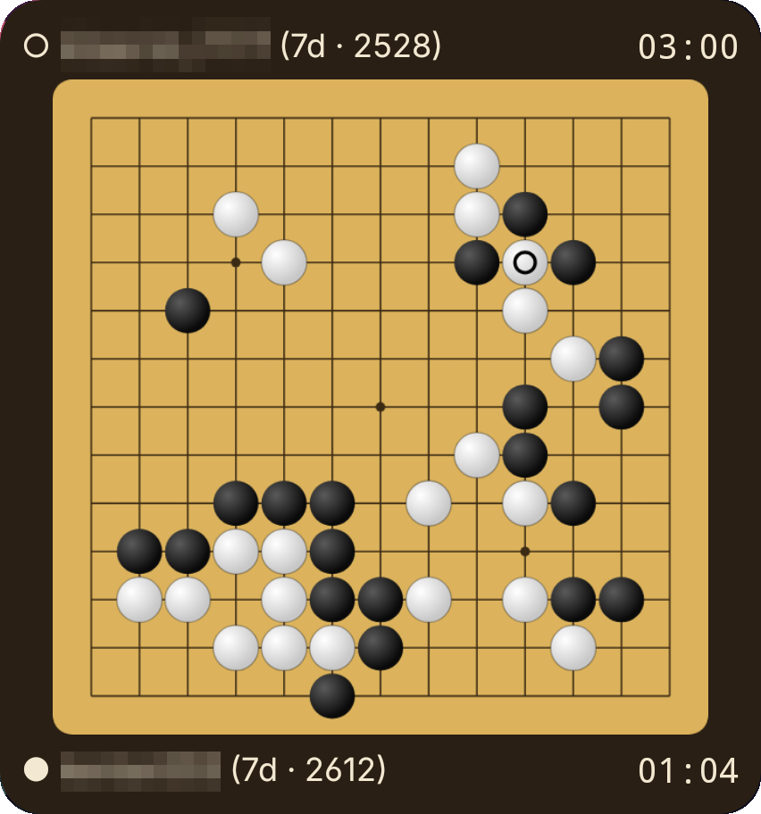
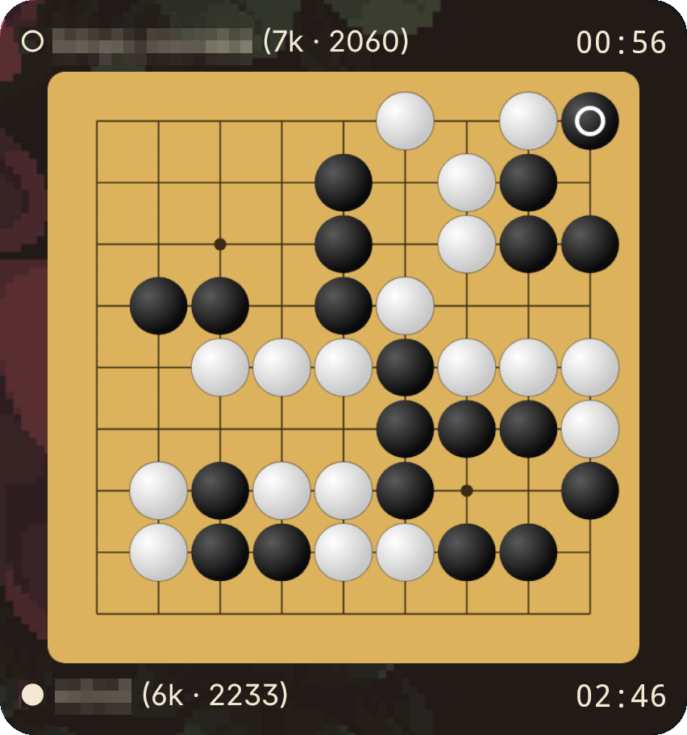

# GoQuest Widget (unofficial)

An Android home-screen widget that shows a live GoQuest game: the strongest game being
played right now, updating move by move. When it ends, the widget moves on to the next one.

> **Unofficial.** This project is not affiliated with or endorsed by MindWalk Corp. or GoQuest
> (囲碁クエスト). GoQuest is a trademark of its respective owner.

<p align="center">
  
  &nbsp;
  
</p>
<p align="center"><sub>13×13 at full opacity, and 9×9 with a translucent background. Player names are blurred.</sub></p>

## Why

GoQuest's spectator mode is one of the best ways to follow strong 9×9 and 13×13 play, but you
have to open the app to see it. This widget puts a live top game on the home screen, which
brings people back into the app and to the games being played. It reads the same public
live-game feed as the app's spectator mode, with no login and no account, and it never plays,
suggests moves or stores player data.

## Features

- **Always a live top game.** The widget watches the first game in GoQuest's live list (sorted
  strongest first). When a game ends, it stays on the result for the *post-game delay*
  (default 5 s, adjustable), then switches to the next one.
- **Board choice:** 9×9, 13×13, 13×13 & 19×19, or 19×19. 19×19 games appear in GoQuest's 13×13
  list. The 13×13 and 19×19 options filter it, and fall back to the whole list when nothing
  matches.
- **Spectate top N games** (default 1): when picking the next game, take the top N and watch
  the one with the fewest moves, so a game that just started wins over one about to end.
- **Players and clocks:** Black's name, rank and rating above the board and White's below,
  marked with ●/○ bullets chosen to match the text colour. Each player's remaining time is on the
  right, and the side to move counts down live. The result ("Wins · Resign", "Wins · 4 pts")
  shows on the winner's row.
- **Looks:** background and board opacity sliders.
- **Battery-friendly:** the connection pauses once the screen has been off for 30 s and
  resumes when it's back on. While spectating, Android shows a silent notification with a Stop
  button.
- **Tap the board** to open the GoQuest app.

Settings open when you add the widget, and later via long-press → Reconfigure (Android 12+) or
the app. Under *Show advanced* are the server address, start/stop, the app version and a
protocol log with a Share button for troubleshooting.

## Install

Download the APK from the [latest release](https://github.com/andy98725/go-quest-widget/releases/latest) and open it on your phone (allow installing from your
browser or file manager when asked). Then long-press the home screen → Widgets →
**GoQuest Widget**.

To build it yourself you need JDK 17+ and the Android SDK (platform 35):

```sh
echo "sdk.dir=$ANDROID_HOME" > local.properties
./gradlew testDebugUnitTest assembleDebug
adb install app/build/outputs/apk/debug/app-debug.apk
```

## How it works

The widget connects to GoQuest's live game server the way the app's spectator mode does. It
asks for the live list, watches one game, and stops watching when the game ends. It identifies
itself honestly as `goquest-widget`. Connection details live in
[`Protocol.kt`](app/src/main/java/com/naptimegames/goquestwidget/protocol/Protocol.kt). Tests run
against a synthetic server transcript, not recorded games.

| Path | What it does |
|---|---|
| `protocol/` | Message framing, parsing, TCP client |
| `SpectatorController.kt` | Picks a game (top N, size filter, fewest moves), follows it, switches after it ends. No Android dependencies; unit-tested |
| `SpectatorService.kt` | Foreground service that owns the connection and updates widgets |
| `model/` | Go board with captures, game info, board modes |
| `widget/` | Widget provider, layout updates, board renderer |
| `ui/SettingsActivity.kt` | Settings and widget configuration screen |

## License

Copyright © 2026 andy98725. All rights reserved. The source is public so it can be reviewed,
but no license to use, copy or distribute it is granted. For licensing or integration, open an
issue or get in touch.

## Open questions

### For MindWalk

1. **Client registration.** The server answers the widget's handshake with
   `{"error":"Unknown vendor_id"}`. Spectating still works, but what is the right way for an
   integration to identify itself?
2. **Board size in the live list.** 19×19 games are mixed into the 13×13 list, and list rows
   don't say a game's size. To filter, the widget briefly opens each unknown game to read its
   size, which adds to that game's spectator count for a moment. A size field in the list would
   remove that.
3. **Server address.** The widget connects to a fixed server address taken from the app's
   traffic. Is there a stable hostname or a lookup endpoint it should use?
4. **Opening a specific game.** Tapping the board opens the GoQuest app, not the game being
   shown. Is there a deep link to a game?
5. **Acceptable use.** Is spectating like this within the terms of service? What request rates or
   connection patterns would they prefer (for example, how often to re-request the live list)?

6. **Status messages.** The server pushes a lobby status message about every 5 s, which a
   widget doesn't need. It keeps the phone's radio awake while the screen is on. Could
   spectating clients opt out?

### Not yet verified

7. **19×19 filter:** never tested live, because no 19×19 game appeared during testing.
8. **Clocks at zero:** the widget's countdown probably goes negative. How GoQuest handles
   running out of time (the meaning of `tcb`/`tci`, any byo-yomi) is unknown.
9. **Unknown list fields:** some fields in live-list rows are always empty or `0` so far, and
   their meaning is unknown.
10. **Keep-alive:** the widget sends an empty line every 60 s, copying the official app. It's
   unconfirmed whether the server needs it.

### Project

11. **Release signing:** release builds are signed with the debug key. Distribution needs a
    real signing key, kept out of the repo.
12. **Name and package:** the app name ("GoQuest Widget") and package
    (`com.naptimegames.goquestwidget`) may need changing, depending on MindWalk's preference.
13. **Licensing:** decide after talking to MindWalk (open source, exclusive, or transfer).
